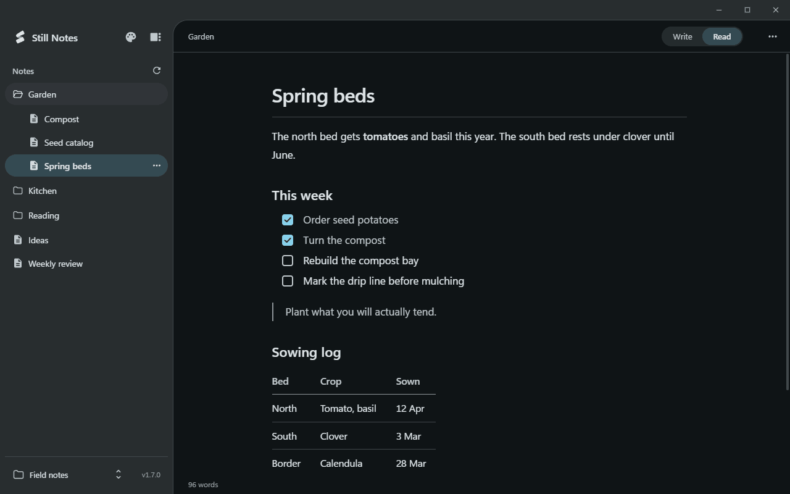
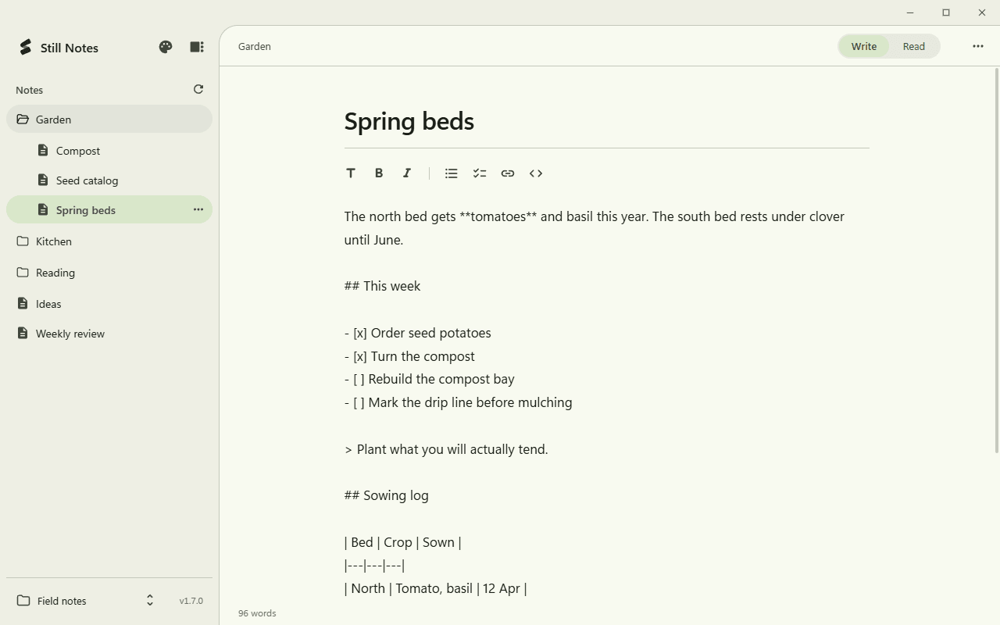
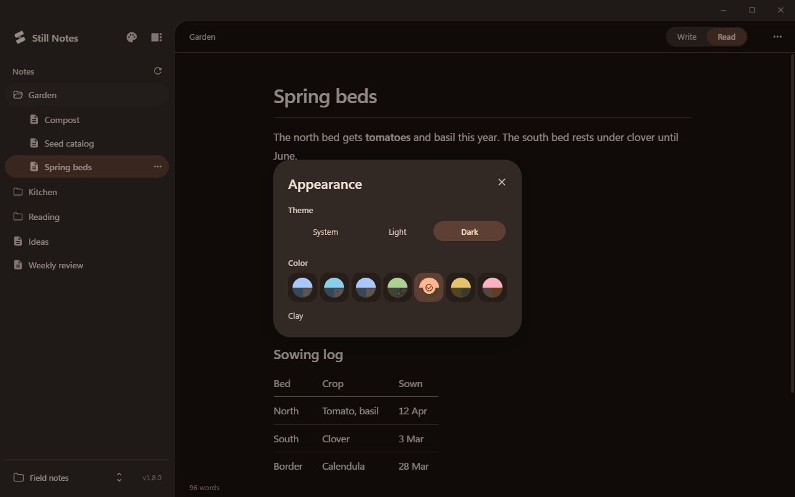

<p align="center">
  
</p>

<h1 align="center">Still Notes</h1>

<p align="center">
  A quiet place to write Markdown on Windows.<br>
  Your notebook is a folder of plain <code>.md</code> files that you own. No account, server, or cloud required.
</p>

<p align="center">
  <a href="https://github.com/tsunsora/still-notes/releases/latest"><b>Download for Windows</b></a>
  &nbsp;·&nbsp;
  <a href="RELEASE-NOTES.md">Release notes</a>
  &nbsp;·&nbsp;
  <a href="https://github.com/tsunsora/still-notes/issues">Report an issue</a>
</p>

<p align="center">
  <picture>
    <source media="(prefers-color-scheme: light)" srcset="docs/screenshot-light.png">
    
  </picture>
</p>

## At a glance

- **Plain Markdown.** Write and preview headings, lists, tasks, links, quotes, code blocks, and tables.
- **Saves on its own.** After a short pause, before you switch notes, and before closing.
- **A familiar sidebar.** Folders, drag-and-drop, note icons, and keyboard shortcuts.
- **Several notebooks.** Switch between local folders; each remembers its own session.
- **Picks up where you left off.** Window, sidebar, open note, reading position, and text selection.
- **Material color.** Light, dark, or system theme, with a Material 3 palette generated from your Windows accent color or one of six presets.

<table>
  <tr>
    <td width="50%"></td>
    <td width="50%"></td>
  </tr>
  <tr>
    <td align="center"><sub>Write mode, light theme with the Moss color</sub></td>
    <td align="center"><sub>Appearance, dark theme with the Clay color</sub></td>
  </tr>
</table>

## Install

1. Download `Still-Notes-Setup-VERSION.exe` from the [latest release](https://github.com/tsunsora/still-notes/releases/latest).
2. Run it, choose where to install, and launch **Still Notes**.
3. Start writing in the **Documents/Still Notes** notebook it creates, or open an existing folder from the bottom of the sidebar.

The installer adds Start menu and desktop shortcuts. Notes are kept apart from the app, so uninstalling leaves your notes and settings in place. Windows may show an unknown-publisher warning because the installer is not Windows code-signed; automatic updates are verified with a separate release-signing key.

Prefer a portable copy? Follow the [development steps](#development), then run `Still Notes.exe` from the `Still Notes-win32-x64` folder, keeping its companion files beside it.

> [!NOTE]
> **Already using Still?** Still Notes is the new name for the same app. The installer upgrades existing installations and shortcuts, keeps the `%APPDATA%\Still` profile and the `com.still.notes` Windows identity, and leaves your notes where they are.

## Everyday use

### Write and organize

| | |
| --- | --- |
| **Create** | Right-click the sidebar, a folder, or a note to create there. `Ctrl+N` and `Ctrl+Shift+N` use the selected folder; click **Notes** above the tree to return to the top level. Names starting with a dot are rejected, since those would be hidden. |
| **Rename or move** | Edit a note's title, or use its three-dot menu. Deleting sends a note or folder to the Recycle Bin. |
| **Read** | Switch from **Write** to **Read** to preview. External links open in your browser; relative links such as `./Note.md` and `../Note.md` open notes in the notebook. HTTPS images load when you're online. |
| **Reorganize** | Drag onto the middle of a folder to move inside it, between rows to reorder, or onto **Notes** to move to the top level. |
| **Import** | Drag Markdown files from Explorer onto a folder to import copies. The originals stay where they are. |
| **Customize** | Use **Change icon** on a note; the first icon resets it. Folder icons are fixed. Drag the sidebar edge to resize it, and double-click to reset. |
| **Appearance** | Click the palette button beside the app name to pick Light, Dark, or System, and a color: your Windows accent or Slate, Ink, Moss, Clay, Ochre, or Rose. |

### Keyboard shortcuts

| Shortcut | Action |
| --- | --- |
| `Ctrl+N` | New note |
| `Ctrl+Shift+N` | New folder |
| `Ctrl+S` | Save now |
| `Ctrl+B` / `Ctrl+I` | Bold / italic |
| `Ctrl+E` | Switch Write / Read |
| `Ctrl+\` | Show / hide sidebar |

### Switch notebooks

Click the folder name at the bottom of the sidebar to pick a saved notebook or **Open another folder**. Pending edits save first, and each folder remembers its last note and sidebar state.

Use **× → Remove** to forget a saved folder, including one that is no longer available. Only the list entry goes; the folder and its notes stay on disk. Removing the active entry also closes that workspace.

### Session restore

Still Notes remembers the window's size, position, and maximized state, and moves it onto an available display if a monitor is disconnected. It also restores sidebar width and visibility, Read/Write mode, and for each notebook the expanded folders, selected folder, open note, scroll position, and text selection. Folder state follows renames and moves. Sessions save as you work and before closing, switching notebooks, or restarting for an update.

## Your files stay safe

- **Save status.** A dot beside Write/Read means a save is in progress; if one fails, **Not saved** appears instead. **Refresh** reloads the tree and the open note.
- **No silent overwrites.** If another app changes a note, Still Notes won't overwrite it. Copy any unsaved text you want to keep, then choose **Reload from disk** from the note menu.
- **Recovery copies.** Every save keeps the previous version in a `.still-recovery` folder beside the note, including edits made through a file handle another editor held open. If a save is interrupted while the note is missing, the next scan restores it. Copies are kept until you delete them and can grow over time. To recover one, move it to another folder and rename `.bak` to `.md`.
- **One window.** Launching again brings the existing window forward instead of opening a second copy on the same profile. While a note loads, its title and text are briefly read-only.

Saving needs a filesystem with hard links, such as NTFS. On other filesystems your edits stay in the app and the original note is restored, so keep notebooks on a supported drive.

Notes live in the folder you choose; appearance, organization, and session settings live separately in Windows application data. Back up your notes folder like any other documents.

An Obsidian vault can be opened as a folder. Still Notes supports standard Markdown, not Obsidian plugins, databases, canvases, or wiki links, and hidden configuration folders don't appear in the sidebar.

## Updates

Installed builds check for updates after launch and every four hours, download new stable versions in the background, and install a ready update quietly when you close the app. Hover over the bottom of the sidebar to see your version and click it to check now. A progress ring shows while an update downloads, and an **Update** button appears when it can be installed with a restart. Either way, pending notes and settings save first; if that fails, your edits stay open. Failed checks retry with growing delays.

Installers are always available from [GitHub Releases](https://github.com/tsunsora/still-notes/releases/latest) without signing in, and running a newer one upgrades in place. Portable builds link to the installer instead of updating themselves. Development and test runs don't contact GitHub unless the optional live-feed check is run.

<details>
<summary><b>How updates are verified</b></summary>
<br>

Every update must carry a release signature made with the app's Ed25519 key. The app embeds the public key and checks the signed app identity, version, filename, and SHA-512 checksum before downloading, then rehashes the cached installer before installing. Altered or unsigned metadata and modified installers are rejected. Builds that include a Windows publisher also require a valid Authenticode signature.

</details>

<details>
<summary><b>Upgrading from an older version</b></summary>
<br>

Version 1.6.7 and later use the public `tsunsora/still-notes` feed without GitHub authentication and update automatically without a Windows signing certificate. Versions 1.6.5 and 1.6.6 had automatic updates turned off, and versions up to 1.6.2 used an older authenticated feed. Install the latest version manually once to move onto the automatic channel.

</details>

## Development

Use **Windows** and **Node.js 22** (the version CI uses). Still Notes is built on **Electron**, with Marked for Markdown, DOMPurify for sanitizing, and Material Color Utilities for theming.

```sh
git clone https://github.com/tsunsora/still-notes.git
cd still-notes
npm ci
npm start
```

| Command | Result |
| --- | --- |
| `npm test` | Unit tests for the updater, session state, note storage, and relative links |
| `npm run test:integration` | All UI and integration checks, including audit regressions |
| `npm run package` | Portable app in `../Still-Windows/Still Notes-win32-x64` |
| `npm run installer` | Signed installer and update metadata in `../Still-Installer`; needs signing credentials |

<details>
<summary><b>Individual checks</b></summary>
<br>

Run these on Windows with dependencies installed. Set `STILL_EXE` to a packaged executable to test a build.

| Command | Covers |
| --- | --- |
| `node tests/regressions.cjs` | Editing guards during navigation, relative links, root-deletion guards, case-only renames, hidden names, single instance |
| `node tests/ui.cjs` | UI and save-before-update behavior |
| `node tests/session.cjs` | Session restore across restarts |
| `node tests/repositories.cjs` | Switching and removing notebooks |
| `node tests/folders.cjs` | Folder animation, icons, and reduced motion |
| `node tests/identity.cjs` | Reuse of the existing Still profile |
| `node tests/update-close.cjs` | Save handshakes before close and restart, with a simulated installer |
| `node tests/unsigned-updates.cjs` | Automatic checks in installed builds without Windows signing |
| `node tests/appearance.cjs` | Material color roles, theme modes, color swatches, and persistence |
| `node tests/github-feed.cjs` | Optional live feed and signature check; needs `STILL_EXE` set to an installer-built executable |

The live-feed check never installs anything. It checks metadata and signatures only, unless `STILL_FEED_DOWNLOAD_TEST=1` is set, in which case it also downloads and verifies the installer in an isolated cache.

</details>

<details>
<summary><b>Publishing a release</b></summary>
<br>

1. Update the version in `package.json` and `package-lock.json`, and edit [RELEASE-NOTES.md](RELEASE-NOTES.md).
2. Keep `STILL_UPDATE_SIGNING_KEY` set as a repository secret holding the Ed25519 private key that matches [src/update-public-key.pem](src/update-public-key.pem). The private key must stay out of the repository, with a protected backup. For local signing, point `STILL_UPDATE_SIGNING_KEY_FILE` at the private PEM file.
3. Optionally set `WIN_CSC_LINK` (a certificate path or base64 PFX) and `WIN_CSC_KEY_PASSWORD` for Windows Authenticode signing. When set, the workflow also requires valid executable signatures and publisher metadata.
4. Push a matching `vVERSION` tag. The [release workflow](.github/workflows/release.yml) checks the version, runs unit and integration tests, builds the installer, signs and verifies its update metadata and checksum, and publishes a complete release through a draft. A missing key, an invalid signature, or a checksum mismatch stops publication.
5. To publish by hand, run `npm run installer`, then `npm run sign-update` with the release key configured. Upload **all five** files together: `Still-Notes-Setup-VERSION.exe`, its `.exe.blockmap`, its `.exe.sig`, `latest.yml`, and `SHA256SUMS.txt`, as a stable release tagged `vVERSION`.

The update feed needs `latest.yml` plus the matching installer signature and checksum. Windows code signing is optional; release signing is always required for automatic updates. Once Windows publisher metadata has shipped, later updates to those installations must use a matching certificate. Local builds never publish automatically, and portable development builds don't update.

> [!WARNING]
> Don't replace the embedded release public key without a migration plan. Existing installations trust that key and reject signatures made with any other.

</details>

## Credits

The Still Notes logo was generated with GPT Image. Interface icons are Google's rounded Material icons under the Apache 2.0 license, and color schemes come from Google's [Material Color Utilities](https://github.com/material-foundation/material-color-utilities), also Apache 2.0. The icons' [license notice](src/MATERIAL-ICONS-LICENSE.txt) ships with the app.

## Visitors

[](https://count.getloli.com/)

Powered by [Moe Counter](https://github.com/journey-ad/Moe-Counter). It counts image requests, not unique visitors, and GitHub's image caching can affect the total.
